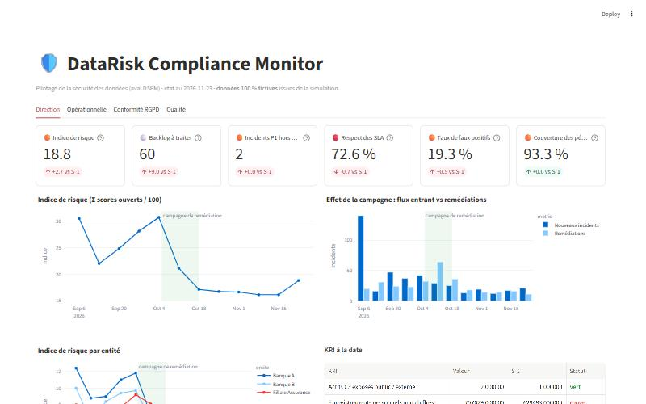
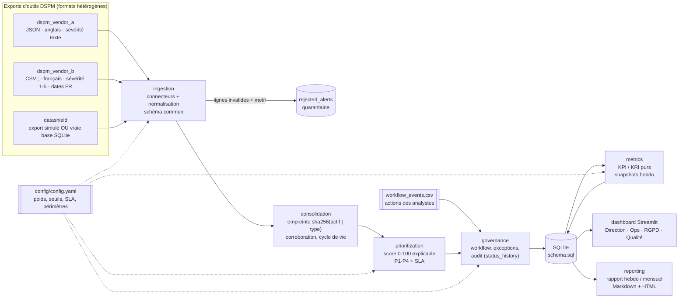
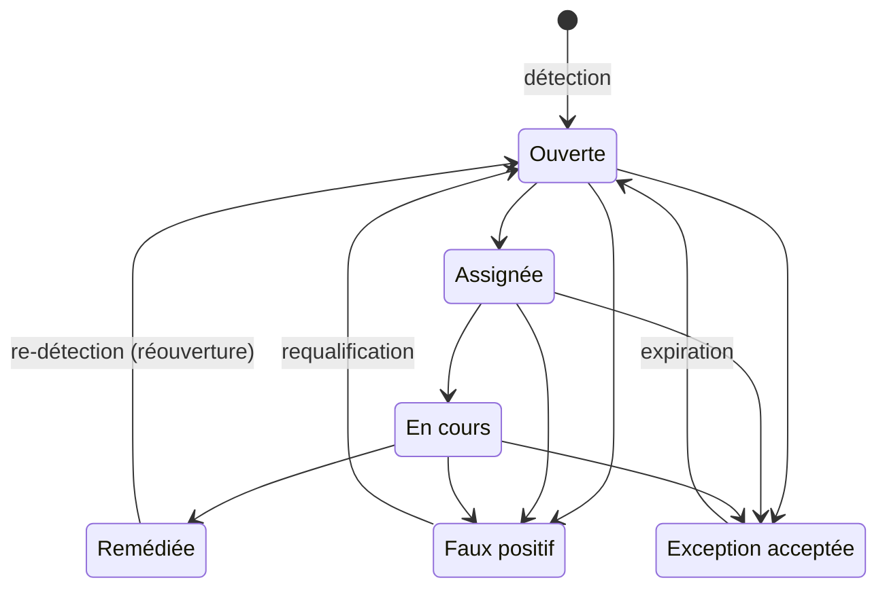
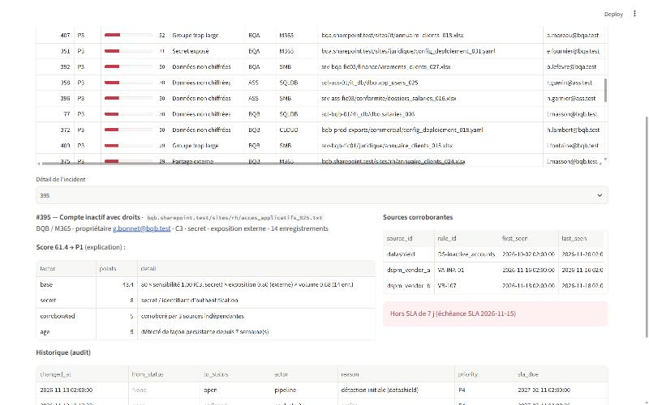
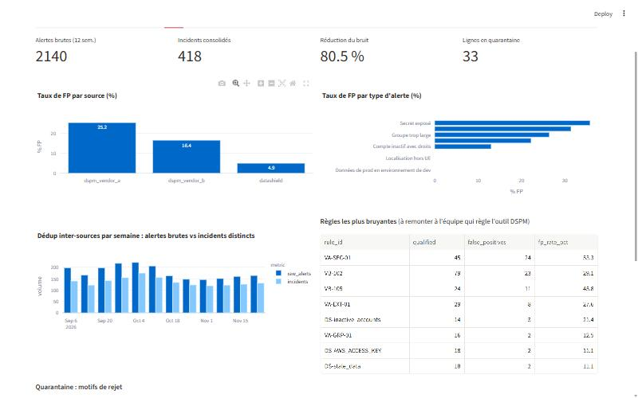

# DataRisk Compliance Monitor

Couche de **pilotage** de la sécurité des données, en aval d'outils **DSPM** (*Data Security Posture
Management*) : elle **consolide** les alertes de plusieurs outils, les **priorise** de façon explicable,
**suit la remédiation** dans le temps (SLA, exceptions, réouvertures), calcule des **KPI / KRI** et produit
des **rapports périodiques** et un **dashboard**.

Stack : Python 3.11 · Pandas · SQLite (SQL explicite) · Streamlit + Plotly · Jinja2 · pytest · ruff.

> ⚠️ **Toutes les données sont FICTIVES.** Entités, actifs, propriétaires (domaines réservés `.test`)
> et alertes sont générés par un simulateur seedé. Les alertes ne contiennent que des **métadonnées** et
> des **échantillons déjà masqués** ; un garde-fou rejette à l'ingestion tout échantillon qui ressemble à
> une valeur en clair. `data/` (exports bruts, base SQLite) n'est jamais commité.



---

## 1. Positionnement : détecter ≠ piloter

Ce projet est le compagnon de [DataShield DSPM Lab](https://github.com/jee-iyed/DataShield-DSPM-Lab).

| | DataShield DSPM Lab | DataRisk Compliance Monitor (ce repo) |
|---|---|---|
| Question | *Où sont mes données sensibles et sont-elles exposées ?* | *Que fait-on de toutes ces alertes, et le risque baisse-t-il ?* |
| Rôle | Découverte, classification (regex + validateurs), exposition, score par fichier | Consolidation **multi-sources**, priorisation, workflow, SLA, gouvernance, KPI/KRI, reporting |
| Entrée | Fichiers d'un SI fictif | Exports d'outils DSPM (JSON, CSV, base DataShield) |
| Horizon | Un scan | **12 semaines** de suivi (tendances, campagne de remédiation) |

Il **ne refait aucune détection** : il part des alertes produites par les outils (dont DataShield, via un
connecteur qui lit directement sa base SQLite).

## 2. Architecture



Alertes et actions analystes sont **rejouées dans l'ordre chronologique** (`datarisk/pipeline.py`) :
chaque décision (réouverture, suppression d'un faux positif, expiration d'exception) est prise avec
l'information disponible à cet instant, comme en production.

## 3. Démarrage rapide

```bash
python -m venv .venv && .venv\Scripts\activate      # Linux/macOS : source .venv/bin/activate
pip install -r requirements.txt
```

```bash
python -m scripts.simulate --seed 42     # 12 semaines d'exports fictifs (3 sources) -> data/raw/
python -m scripts.ingest                 # normalisation -> consolidation -> score -> workflow -> data/datarisk.db
python -m scripts.build_metrics          # snapshots hebdomadaires KPI/KRI + chiffres clés
streamlit run dashboard/app.py           # dashboard sur http://localhost:8501
```

Rapports et tests :

```bash
python -m scripts.generate_report --period weekly --date 2026-11-22    # -> reports/report_weekly_2026-11-22.{md,html}
python -m scripts.generate_report --period monthly --date 2026-10-31
python -m pytest        # 77 tests
ruff check .
```

Exemples réellement générés : [`reports/examples/`](reports/examples/).

## 4. Le pipeline, étape par étape

### 4.1 Simulateur (`datarisk/simulator/`)
On simule d'abord **la vérité** (510 actifs sur 3 entités × 5 périmètres, des problèmes réels ou des faux
positifs d'outil, leur date d'apparition, de correction), puis **ce que chaque outil en voit** et **ce que
font les analystes**. Réalisme modélisé : doublons inter-sources, re-détections hebdomadaires, scans
manqués, faux positifs portés par des règles bruyantes, régressions (réouvertures), exceptions avec
expiration, périmètres raccordés en cours de route, **campagne de remédiation** semaines 6-7.

### 4.2 Normalisation (`datarisk/ingestion/`)
Schéma commun : `alert_id, source, source_alert_id, rule_id, alert_type, entity, perimeter, asset_path,
asset_id, data_owner, data_types, classification (C0–C3), rgpd_category, exposure, encrypted, environment,
location, in_eu, record_count, masked_sample, first_seen, last_seen, status, raw_severity, normalized_severity`.

| Sévérité commune | dspm_vendor_a (texte) | dspm_vendor_b (1–5) | datashield |
|---|---|---|---|
| 1 Faible | `info`, `low` | 1, 2 | Faible |
| 2 Moyenne | `medium` | 3 | Moyen |
| 3 Élevée | `high` | 4 | Élevé |
| 4 Critique | `critical` | 5 | Critique |

- Chemins **canonisés** (`smb://SRV/RH/x`, `\\srv\RH\x` → `srv/rh/x`) : c'est ce qui rend la déduplication
  inter-sources possible.
- Une alerte DataShield (1 par fichier, n facteurs aggravants) est **dépliée** en 1 alerte par type.
- Toute ligne invalide (date impossible, sévérité inconnue, entité inconnue, chemin manquant, volume négatif,
  **échantillon non masqué**…) part en **quarantaine** (`rejected_alerts`) avec son motif, échantillon retiré.

### 4.3 Consolidation (`datarisk/consolidation/`)
Empreinte `sha256(chemin canonique | type d'alerte)[:16]` → N détections = **1 incident de données**, avec la
liste des sources qui l'ont vu. Attributs fusionnés au **plus défavorable** (principe de précaution).
Cycle de vie : nouvelle → récurrente → (résolue) → réouverte ; les re-détections d'un faux positif déjà
qualifié sont **supprimées** (comptées, pas ré-ouvertes).

### 4.4 Priorisation explicable (`datarisk/prioritization/`)

```
score = 80 × sensibilité × exposition × volume  +  bonus        (borné à 100)
  sensibilité = poids classification (C0 .10 · C1 .35 · C2 .70 · C3 .90) + bonus RGPD (≤ .10), plafonné à 1
  exposition  = public 1.0 · externe 0.8 · groupe large 0.55 · restreint 0.3
  volume      = 0.6 → 1.0 en échelle log (1 → 1 000 000 enregistrements)
  bonus       = non chiffré ≥ C2 +6 · prod en dev +6 · hors UE +5 · secret +8
                · corroboré par ≥ 2 sources +5 · persistance +1/semaine (max +5)
```

| Priorité | Score | SLA de remédiation |
|---|---|---|
| P1 Critique | ≥ 60 | 2 jours |
| P2 Élevé | ≥ 45 | 7 jours |
| P3 Moyen | ≥ 28 | 30 jours |
| P4 Faible | < 28 | 90 jours |

Chaque score est stocké avec **la liste de ses contributions** (affichée dans le dashboard). L'échéance
SLA est fixée à l'ouverture du cycle et **se resserre** (jamais ne se relâche) si la priorité monte.
Tous les poids et seuils sont dans `config/config.yaml`.

### 4.5 Gouvernance (`datarisk/governance/`)



- Une exception exige **justification + validateur + date d'expiration future** ; expirée, elle redevient une alerte.
- Chaque transition est écrite dans `status_history` avec priorité, score et échéance SLA du moment :
  on peut **reconstituer l'état à n'importe quelle date** (base des snapshots et des comparaisons de période).
- Une action invalide (transition interdite, incident inconnu) est refusée et tracée en quarantaine.

### 4.6 Stockage (`datarisk/storage/schema.sql`)
`sources, entities, perimeters, owners, scan_coverage, raw_alerts, rejected_alerts, incidents,
incident_sources, status_history, exceptions, metric_snapshots` + index. 10 requêtes d'analyse commentées
(fenêtres `LAG`, `ROW_NUMBER`, MTTR sur l'historique…) dans [`docs/queries.sql`](docs/queries.sql), toutes
exécutées par les tests.

## 5. KPI et KRI

**KPI** = performance du dispositif (*travaille-t-on bien ?*). **KRI** = niveau de risque résiduel
(*à quel point sommes-nous exposés ?*). Un KPI peut être vert pendant qu'un KRI est rouge : c'est
précisément ce qu'on veut voir. Seuils vert / orange / rouge dans `config.yaml`.

| | Indicateur | Formule | Pourquoi il compte |
|---|---|---|---|
| KPI | Couverture | (entité × périmètre) scannés / attendus | Un risque non scanné est invisible |
| KPI | Réduction du bruit | 1 − incidents distincts / alertes brutes | Ce que la dédup épargne aux analystes |
| KPI | Taux de faux positifs | FP / incidents qualifiés (remédiés + FP + exceptions) ; aussi par source, règle, type | Coût du bruit, pilote le réglage des règles |
| KPI | MTTR moyen / médian | délai ouverture → remédiation des cycles remédiés, par priorité | Vitesse de réduction du risque |
| KPI | Respect des SLA | cycles remédiés avant échéance / cycles remédiés (global et par priorité) | Tenue des engagements |
| KPI | Backlog et âge | incidents Ouverte/Assignée/En cours ; âge du cycle en cours | Capacité de traitement |
| KPI | Taux de réouverture | Remédiée → Ouverte / remédiations | Qualité des corrections |
| KRI | Actifs C3 exposés public / externe | actifs distincts C3 avec exposition publique ou partage externe à traiter | Scénario de fuite le plus direct |
| KRI | Enregistrements personnels non chiffrés | Σ enregistrements (personnels, bancaires, art. 9) des incidents « non chiffré » | Ordre de grandeur de l'impact (RGPD art. 32-34) |
| KRI | Secrets exposés non révoqués | incidents « secret exposé » à traiter | Accès direct au SI |
| KRI | Données hors rétention | incidents « hors durée de conservation » à traiter | RGPD art. 5.1.e |
| KRI | P1 hors SLA | incidents P1 à traiter dont l'échéance est passée | Risque critique connu non traité |
| KRI | Indice de risque | Σ scores des incidents à traiter / 100, par entité et périmètre | Agrégat comparable dans le temps |

Conventions : indicateurs de **flux** sur la période, de **stock** à la date, de **qualité** (FP, MTTR, SLA)
cumulés depuis le début. Les exceptions acceptées sont un risque **accepté**, compté à part.
Définitions complètes : `datarisk/metrics/definitions.py` (reprises dans l'annexe des rapports).

## 6. Résultats obtenus sur la simulation (seed 42)

Tous les chiffres ci-dessous sont **copiés de la sortie** de :
`python -m scripts.simulate --seed 42 && python -m scripts.ingest && python -m scripts.build_metrics`
(période du 2026-08-31 au 2026-11-22). Ils décrivent des données fictives : ils valident la mécanique,
pas une performance réelle.

**Volume et consolidation**

| | Valeur |
|---|---|
| Actifs simulés / problèmes simulés (dont faux positifs d'outil) | 510 / 472 (94) |
| Lignes exportées (vendor A / vendor B / DataShield) | 600 / 951 / 575 |
| Alertes normalisées → **incidents consolidés** | **2 140 → 418 (réduction du bruit 80,5 %)** |
| Incidents vus par ≥ 2 sources (corroboration) | 43,3 % |
| Dédup inter-sources à l'intérieur d'une semaine | 16,9 % à 29,3 % selon la semaine |
| Lignes en quarantaine | 22 lignes sources + 11 actions analystes refusées (incident jamais ingéré) |
| Re-détections de faux positifs supprimées | 523 |
| Répartition des priorités | P1 37 · P2 82 · P3 202 · P4 97 |

**Qualité et délais**

| | Valeur |
|---|---|
| Taux de FP global | 19,3 % |
| Taux de FP par source | vendor A 25,2 % · vendor B 16,4 % · DataShield 4,9 % |
| Règles les plus bruyantes | `VA-SEC-01` 53,3 % (24/45) · `VB-105` 45,8 % (11/24) · `VB-102` 29,1 % (23/79) |
| MTTR moyen / médian | 14,1 j / 10,3 j (P1 5,5 / 4,4 j · P2 9,4 / 8,1 j · P3 16,4 / 12,0 j · P4 15,8 / 14,5 j) |
| Respect des SLA | 72,6 % (P1 8,3 % · P2 40,7 % · P3 83,6 % · P4 100 %) |
| Taux de réouverture | 5,9 % (18 réouvertures) |
| Exceptions | 18 accordées, 14 expirées (redevenues des alertes), 4 actives |

**Tendances sur 12 semaines (effet de la campagne de remédiation, semaines 6-7)**

| | Semaine 1 | Pic | Semaine 12 |
|---|---|---|---|
| Indice de risque | 30,5 | 30,7 (2026-10-04) | 18,8 |
| Backlog à traiter | 99 | 102 (2026-10-04) | 60 |
| Remédiations dans la semaine | 20 | **64** (semaine 6) | 11 |
| Couverture | 80,0 % | — | 93,3 % (1 périmètre jamais raccordé) |

KRI en fin de période : 2 actifs C3 exposés (vert) · 757 029 enregistrements personnels non chiffrés
(rouge, en hausse depuis 394 120) · 6 secrets non révoqués (rouge) · 6 jeux hors rétention (orange) ·
2 P1 hors SLA (orange).

**Lecture** : la campagne fait baisser l'indice de risque de ~39 % (30,7 → 18,8) et le backlog, mais le
SLA P1 de 2 jours n'est tenu que dans 8,3 % des cas et le volume non chiffré continue de croître : les deux
messages à porter en comité (SLA P1 irréaliste ou capacité insuffisante ; chantier chiffrement). Côté
outillage, la règle `VA-SEC-01` (secrets) produit plus de faux positifs que de vrais : à remonter à
l'équipe qui règle l'outil.

## 7. Connecteur DataShield (testé sur une vraie base)

```bash
# dans DataShield-DSPM-Lab : python -m scripts.seed && python -m scripts.run_scan
python -m scripts.ingest --datashield-db ../DataShield-DSPM-Lab/data/datashield.db --db data/datarisk_ds.db
```

Le connecteur lit la base en **lecture seule** (`alerts ⨝ files ⨝ repositories` + `findings`). Exécuté sur
une base produite par DataShield DSPM Lab (seed 42) : **161 alertes lues, 0 rejet, 8 sans type actionnable
(accès restreint, aucun facteur), 346 alertes normalisées**. DataShield n'ayant pas de notion d'entité, elles
sont rattachées à `datashield.default_entity` (config). Dans ce mode, le journal d'actions simulé ne
correspond pas aux fichiers DataShield : ses actions sur ces incidents sont refusées (tracées).

## 8. Captures

| Opérationnelle : file priorisée, explication du score, sources, SLA, audit | Qualité : FP par source / type, règles bruyantes, dédup |
|---|---|
|  |  |

## 9. Structure

```
datarisk/
  simulator/       world.py (vérité + analystes), exports.py (3 formats + lignes corrompues)
  ingestion/       normalize.py (mappings, validation, masquage), connectors.py (fichiers, SQLite DataShield)
  consolidation/   dedup.py (empreinte, incident, fusion, cycle de vie)
  prioritization/  scoring.py (score explicable, P1-P4, SLA)
  governance/      workflow.py (transitions, exceptions, audit)
  metrics/         kpi.py, kri.py (fonctions pures), state.py (état à une date), snapshots.py, definitions.py
  reporting/       report.py + templates/report.html.j2
  storage/         schema.sql, db.py
  pipeline.py      rejeu chronologique
dashboard/app.py   Streamlit (4 vues)
scripts/           simulate.py, ingest.py, build_metrics.py, generate_report.py
config/config.yaml poids, seuils, SLA, rétention, périmètres
docs/              DECISIONS.md, INTERVIEW_NOTES.md, queries.sql, screenshots/
reports/examples/  rapports générés
tests/             77 tests pytest
```

## 10. Limites (honnêtes)

- **Données simulées** : les distributions (taux de FP, délais, campagne) sont des choix de simulation ; les
  chiffres valident la mécanique, pas une performance réelle. Le comportement des analystes est simulé à
  partir d'une urgence « perçue » qui n'est pas exactement la priorité calculée — d'où, en partie, le faible
  respect du SLA P1.
- **Pas de connecteur vers un vrai éditeur DSPM** (Varonis, Microsoft Purview, Cyera…) : les formats
  vendor A / B sont inventés. Seul DataShield (mon autre projet) est lu tel quel.
- **SLA, poids et seuils arbitraires**, à calibrer avec la politique de l'organisation (ils sont centralisés
  dans `config.yaml` pour cela).
- **Score** : les attributs d'un incident sont ses valeurs les plus récentes / les plus défavorables ; les
  snapshots reconstituent statut, priorité, score et SLA depuis l'historique, mais pas l'évolution des
  attributs (classification, exposition).
- **Réouverture** basée sur la re-détection du même actif + type : un fichier renommé ou déplacé crée un
  nouvel incident (pas de corrélation par contenu / hash de fichier).
- **SQLite mono-utilisateur**, pas d'authentification ni de RBAC sur le dashboard, pas d'API d'écriture
  (le workflow est alimenté par un journal CSV, pas par une interface de ticketing).
- Pas d'export PDF (le HTML s'imprime proprement depuis le navigateur) ; pas d'image Docker.
